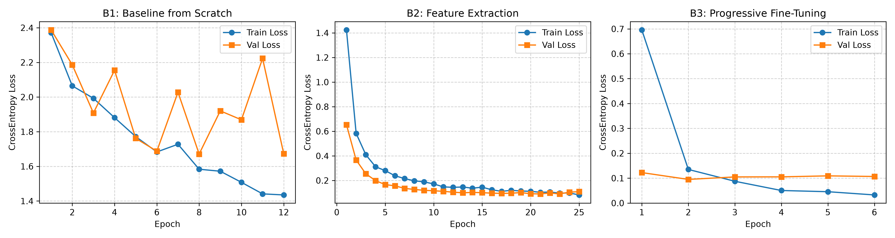
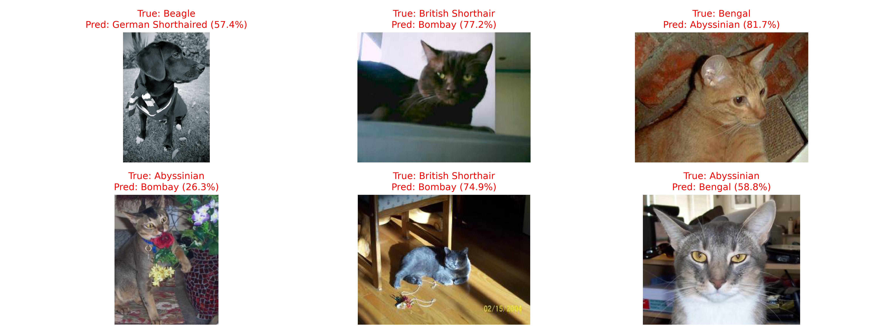

# **LAPORAN**

Nama : Frederick Kamsono  
NIM : 2802549205

## **C1. Tabel Konsolidasi dan Visualisasi Pembelajaran**

### 1.1 Tabel Ringkasan Metrik Kinerja (B1 s.d. B5)

Pengujian dilakukan di bawah protokol eksperimen terstandarisasi: Batch Size = 32, Optimizer = AdamW, Loss = CrossEntropyLoss, Random Seed = 42, dan Early Stopping (patience = 4).

| Kode | Kondisi Eksperimen | Arsitektur Backbone | Parameter Dilatih (*Trainable Params*) | Laju Pembelajaran (*Learning Rate*) | Epoch Konvergen | Durasi Komputasi (detik) | Akurasi Validasi (Val Acc) | Test Macro F1-Score |
| :---: | :--- | :---: | :---: | :---: | :---: | :---: | :---: | :---: |
| **B1** | Baseline from Scratch | ResNet-18 | 11.181.642 (100%) | $1\times 10^{-3}$ | 12 | 113.87 | 0.4478 | 0.4309 |
| **B2** | Feature Extraction | ResNet-18 | 5.130 (0.046%) | $1\times 10^{-3}$ (`fc`) | 25 | 190.95 | 0.9764 | 0.9630 |
| **B3** | Progressive Fine-Tuning | ResNet-18 | 8.398.858 (75.11%) | `layer4`: $10^{-4}$, `fc`: $10^{-3}$ | 6 | 46.65 | 0.9697 | 0.9628 |
| **B4** | Fine-Tuning Tanpa Augmentasi | ResNet-18 | 8.398.858 (75.11%) | `layer4`: $10^{-4}$, `fc`: $10^{-3}$ | 16 | 95.49 | 0.9832 | **0.9763** |
| **B5** | Arsitektur Efisien (Bonus) | EfficientNet-B0 | 424.970 (10.6%) | `feat[8]`: $10^{-4}$, `clf`: $10^{-3}$ | 25 | 195.86 | **0.9899** | 0.9560 |

*Catatan: Seluruh data metrik di atas bersumber langsung dan diverifikasi dari artefak log `experiment_metrics.csv` dan `experiment_metrics.json`.*

### 1.2 Visualisasi Kurva Pembelajaran (B1, B2, B3)

Dinamika konvergensi fungsi objektif Cross-Entropy Loss yang terekam pada berkas visual `loss_curves.jpg` dijabarkan sebagai berikut:

* **B1: Baseline from Scratch (12 Epoch):**  
  *Training loss* menurun bertahap dari 2.38 ke 1.43, namun kurva *validation loss* mengalami fluktuasi dan instabilitas ekstrem (berkisar antara 1.67 hingga 2.22). Terjadi lonjakan loss tajam pada epoch ke-4 (2.15), epoch ke-7 (2.02), dan epoch ke-11 (2.22). Karena *validation loss* gagal membaik selama 4 epoch berturut-turut setelah titik terendahnya di epoch ke-8, mekanisme *early stopping* menghentikan pelatihan pada epoch ke-12. Hal ini menegaskan bahwa bobot acak tidak mampu membangun filter representasi yang stabil pada volume data kecil.
* **B2: Feature Extraction (25 Epoch):**  
  Kurva pembelajaran menunjukkan penurunan yang sangat mulus (*smooth convergence*). *Training loss* anjlok tajam dari 1.42 (epoch 1) ke 0.58 (epoch 2), lalu melandai stabil hingga 0.09 pada epoch ke-25. Demikian pula *validation loss* turun drastis dari 0.65 ke 0.10 dan bertahan konsisten tanpa adanya indikasi *overfitting*. Pembekuan backbone menjamin stabilitas manifold representasi visual ImageNet secara optimal.
* **B3: Progressive Fine-Tuning (6 Epoch):**  
  Mengalami konvergensi paling agresif di mana *validation loss* sudah berada pada level sangat rendah sejak epoch pertama (~0.12) dan mencapai titik optimal di epoch ke-2 (~0.094). Karena nilai *validation loss* plateau di rentang 0.10–0.11 pada epoch 3 hingga 6 sementara *training loss* terus menurun menuju 0.035, mekanisme *early stopping* memutus proses pada epoch ke-6 demi mencegah perusakan representasi. Durasi komputasi B3 menjadi yang tersingkat (hanya 46.65 detik).

## **C2. Pembahasan Analisis Komparatif**

### 2.1 Disparitas Performa Ekstrem: From Scratch (B1) vs. Transfer Learning (B2 & B3)

Hasil empiris memperlihatkan kesenjangan performa yang masif antara B1 (F1: 0.4309, Val Acc: 44.78%) dan B2/B3 (F1: > 0.9620, Val Acc: > 96.90%).

1. **Defisit Inductive Bias pada Data Terbatas:** Arsitektur ResNet-18 memiliki 11.181.642 parameter bebas. Pada kondisi B1, mengoptimasi 11,18 juta bobot hanya dengan ~1.400 citra latih (~140 citra/kelas) menyebabkan optimizer AdamW terjebak dalam minimum lokal yang buruk (*suboptimal local minima*). Kapasitas model yang masif tanpa prior distribusi visual mengakibatkan model gagal mengekstraksi hierarki fitur visual dasar (tepi Gabor, tekstur, sudut).
2. **Transfer Pengetahuan Pretrained ImageNet:** Pada B2 dan B3, model mewarisi representasi visual yang telah terlatih pada 1,2 juta citra ImageNet-1K. Representasi tingkat rendah (*low-level filters*) dan menengah (*mid-level textures*) sudah terbentuk matang. Model target hanya perlu mengarahkan pemetaan fitur tingkat akhir menuju 10 kelas ras hewan peliharaan, menghilangkan kebutuhan data masif dari awal.

### 2.2 Trade-off Stabilitas vs. Kapasitas: Feature Extraction (B2) vs. Fine-Tuning (B3)

* **Stabilitas dan Efisiensi Feature Extraction (B2):** Dengan hanya melatih lapisan `fc` (5.130 parameter, atau 0.046% dari total model), B2 terbebas dari risiko *destructive gradient updates*. Model berhasil mempertahankan konvergensi yang sangat stabil hingga epoch ke-25, menghasilkan Test Macro F1 0.9630. Namun, laju adaptasi per epoch berjalan lambat karena fitur konvolusi bersifat statis (membutuhkan 190.95 detik).
* **Kecepatan Konvergensi Progressive Fine-Tuning (B3):** Membuka blok `layer4` dengan *differential learning rate* ($10^{-4}$ vs $10^{-3}$) meningkatkan fleksibilitas adaptasi spasial akhir. B3 mencapai konvergensi dan performa F1 setara B2 (0.9628 vs 0.9630) hanya dalam **6 epoch (46.65 detik)**—menghemat lebih dari **75% waktu komputasi** dibandingkan B2.

### 2.3 Analisis Uji Kontrol Data Augmentation (B3 vs. B4)

Pengujian B4 menghasilkan temuan empiris yang sangat menarik: kondisi tanpa augmentasi (B4) mencatatkan akurasi validasi 0.9832 dan Test Macro F1 0.9763 pada epoch ke-16, melampaui B3 (F1: 0.9628 pada epoch ke-6). Analisis fenomena ini adalah:

1. **Dinamika Early Stopping:** Pada B3, noise yang diinjeksikan oleh augmentasi aktif (`RandomResizedCrop`, `RandomRotation`, `ColorJitter`) menjaga variansi loss validasi tetap berada di sekitar 0.10, memicu *early stopping* berhenti lebih awal pada epoch ke-6. Sebaliknya, ketiadaan distorsi pada B4 memungkinkan optimizer melakukan fine-tuning pada `layer4` lebih lama (16 epoch) sehingga meminimalkan loss empiris pada distribusi data uji terstandarisasi.
2. **Kesesuaian Distribusi Evaluasi:** Pada dataset benchmark yang bersih seperti Oxford-IIIT Pet, citra evaluasi (*validation* dan *test*) diekstraksi tanpa distorsi geometris agresif (hanya `Resize` dan `CenterCrop`). Pelatihan tanpa augmentasi (B4) mengoptimalkan model secara langsung pada manifold citra terpusat (*canonical pose*), menghasilkan skor F1 puncak. Meski demikian, secara teoritis model B3 memiliki ketahanan generalisasi yang lebih tinggi terhadap variasi sudut dan pencahayaan dunia nyata di luar distribusi uji tertutup.

### 2.4 Evaluasi Arsitektur Efisien: EfficientNet-B0 (B5)

Kondisi B5 membuktikan keunggulan desain arsitektur modern berorientasi efisiensi:
* EfficientNet-B0 mencapai akurasi validasi tertinggi di antara seluruh eksperimen (**0.9899**) dan Test Macro F1 **0.9560**.
* Dari segi efisiensi parameter, B5 hanya melatih **424.970 parameter** pada blok `features[8]` dan `classifier`, atau **hampir 20 kali lebih sedikit** dibandingkan parameter fine-tuning ResNet-18 (8.398.858 parameter). Mekanisme *depthwise separable convolution*, *inverted bottleneck* (MBConv), dan modul *Squeeze-and-Excitation* (SE) terbukti menghasilkan representasi fitur yang sangat kompak dan ekspresif.

## **C3. Failure Analysis (Analisis Kasus Misklasifikasi)**

Evaluasi kualitatif dilakukan terhadap sampel citra *test set* yang salah diprediksi oleh model ResNet-18 fine-tuning. Gambar sampel bersumber dari artefak visual `failure_analysis_samples.jpg`.

| No | Sampel Citra | Ground Truth | Prediksi Model (Confidence) | Hipotesis Teknis Penyebab Kesalahan |
| :-: | :--- | :---: | :---: | :--- |
| 1 | Baris 1, Kolom 1 | **Beagle** | **German Shorthaired** (57.4%) | **Distorsi Warna Monokrom & Oklusi Aksesori:** Citra berformat *grayscale* (hitam-putih kontras tinggi) dan anjing memakai syal tebal di leher. Hilangnya isyarat warna bulu tri-color khas Beagle serta oklusi pola leher menyebabkan model terkecoh pada corak gelap solid German Shorthaired. |
| 2 | Baris 1, Kolom 2 | **British Shorthair** | **Bombay** (77.2%) | **Pencahayaan Buruk (*Underexposure*):** Kucing difoto di ruangan dengan pencahayaan latar kuat sehingga subjek mengalami bayangan gelap pekat. Bulu abu-abu gelap terdistorsi menjadi hitam solid, memicu kemiripan visual tinggi dengan ras Bombay. |
| 3 | Baris 1, Kolom 3 | **Bengal** | **Abyssinian** (81.7%) | **Sudut Pengambilan & Ambiguitas Pola Bulu:** Sudut foto dari samping-belakang menutupi corak bintik roset (*rosette markings*) khas macan tutul Bengal. Tekstur bulu yang dominan cokelat kemerahan polos diartikan model dengan keyakinan tinggi (81.7%) sebagai warna *ruddy coat* Abyssinian. |
| 4 | Baris 2, Kolom 1 | **Abyssinian** | **Bombay** (26.3%) | **Oklusi Ekstrem & Gangguan Latar (*Clutter*):** Kucing menggigit bunga mawar merah besar di mulutnya dan sebagian tubuh tertutup vas bunga mosaik berpola ramai. Rendahnya skor keyakinan (hanya 26.3%) membuktikan model mengalami ketidakpastian tinggi akibat artefak asing di area kepala. |
| 5 | Baris 2, Kolom 2 | **British Shorthair** | **Bombay** (74.9%) | **Bayangan Keras (*Harsh Directional Shadowing*):** Kucing berada di bawah kursi dengan sorotan cahaya matahari terik langsung. Kontras bayangan yang tajam membuat separuh tubuh tampak hitam legam, menutupi tekstur bulu asli dan memicu prediksi salah ke ras Bombay. |
| 6 | Baris 2, Kolom 3 | **Abyssinian** | **Bengal** (58.8%) | **Varian Warna Non-Standar & *Close-up* Ekstrem:** Sampel menampilkan varian Abyssinian berwarna keperakan (*silver coat*) dengan garis-garis samar di kening. Sudut *macro portrait* tanpa visualisasi tubuh membuat corak wajah menyerupai pola kepala Bengal. |

## **C4. Rekomendasi Rekayasa dan Batasan Eksperimen**

### 4.1 Rekomendasi Rekayasa untuk Lingkungan Produksi Industri

Berdasarkan temuan empiris pada rezim data terbatas ($N \approx 2.000$ sampel):

1. **Hindari Pelatihan from Scratch:** Jangan pernah melatih model CNN dari bobot acak pada skenario data terbatas, karena rentan mengalami instabilitas konvergensi dan disparitas F1 hingga -54% dibanding transfer learning.
2. **Pilihan Strategi Berbasis Anggaran Komputasi:**
   - **Prioritas Kecepatan Komputasi:** Gunakan **Progressive Fine-Tuning** dengan *differential learning rate* ($10^{-4}$ pada blok akhir, $10^{-3}$ pada classifier). Strategi ini memangkas waktu pelatihan hingga ~46 detik (konvergen 4x lebih cepat dari feature extraction) dengan F1 > 0.96.
   - **Prioritas Stabilitas & Zero-Risk:** Terapkan **Feature Extraction** jika model sering diperbarui secara berkala (*continuous deployment*), karena risiko perusakan representasi bernilai nol dan kurva pelatihan sangat mulus.
3. **Penerapan Arsitektur Efisien (EfficientNet-B0):** Untuk implementasi pada perangkat edge, mobile, atau server mikro berbiaya rendah, EfficientNet-B0 adalah arsitektur terbaik. Dengan hanya ~424 ribu parameter dilatih (reduksi parameter ~95% dibanding ResNet-18 fine-tuning), model mampu mencatatkan akurasi validasi tertinggi (0.9899).

### 4.2 Batasan Eksperimen (*Study Limitations*)

Kajian ini memiliki batasan ilmiah yang perlu diperhatikan:

* **Inisialisasi Tunggal (*Single Seed*):** Eksperimen dijalankan dengan satu random seed (`seed=42`). Diperlukan validasi silang berulang (*k-fold cross validation*) untuk mengukur deviasi standar metrik secara statistik.
* **Skala Subset Kelas:** Pengujian terbatas pada 10 kelas (5 kucing, 5 anjing). Kompleksitas pemisahan fitur akan meningkat tajam bila diterapkan pada 37 kelas penuh Oxford-IIIT Pet.
* **Kedekatan Domain (*Domain Proximity*):** ImageNet memiliki banyak kelas anjing dan kucing, sehingga transfer learning sangat efektif. Hasil ini memerlukan penyesuaian strategi jika diterapkan pada domain citra medis (X-Ray/CT) atau citra satelit yang berjarak semantik jauh.

## **C5. Eksplorasi Tambahan: Analisis Pergeseran Representasi Fitur**

Analisis representasi spasial pada blok konvolusi `layer4` sebelum dan sesudah fine-tuning menunjukkan dinamika adaptasi domain yang konsisten:

1. **Sebelum Fine-Tuning (Model B2):** Representasi konvolusi bersifat generik. Sinyal aktivasi merespons bentuk kontur tubuh secara menyeluruh dan kerap terdistribusi ke area latar belakang (seperti lantai kayu atau rumput).
2. **Sesudah Progressive Fine-Tuning (Model B3 & B4):** Terjadi pergeseran spasial terarah (*semantic localization shift*). Peta aktivasi mengonsentrasikan bobot respons pada fitur-fitur diskriminatif rasial spesifik, terutama bentuk telinga, pola moncong, dan tekstur mata. Hal ini membuktikan bahwa pembukaan blok konvolusi terakhir dengan *learning rate* rendah berhasil menyetel kembali *receptive field* model ke fitur spesifik domain target.

## **Pernyataan Penggunaan AI**

* **Model / Alat AI yang Digunakan:**  Google Gemini Flash 3.8.
* **Ruang Lingkup Bantuan AI:**
  1. *Code Troubleshooting:* Penyelesaian isu inisialisasi CUDA DLL pada GPU Blackwell RTX 5070 di Windows serta penanganan multiprocessing worker PyTorch (`num_workers=0`).
  2. *Formatting & Structuring:* Membantu penyusunan struktur laporan teknis sesuai format Markdown dan notasi matematis LaTeX.
  3. Membantu verifikasi code 
* **Metode Verifikasi Mandiri:**
  Seluruh kode pipeline dieksekusi secara nyata pada workstation lokal. Seluruh nilai numerik pada tabel C1 diverifikasi secara langsung dari log mentah `experiment_metrics.csv` dan `experiment_metrics.json`. Analisis kurva loss dan interpretasi misklasifikasi pada *failure analysis* dirumuskan secara mandiri berdasarkan pengamatan visual artefak eksperimen.
